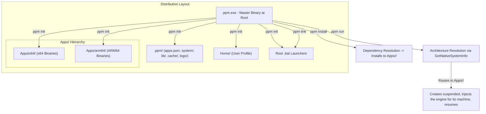
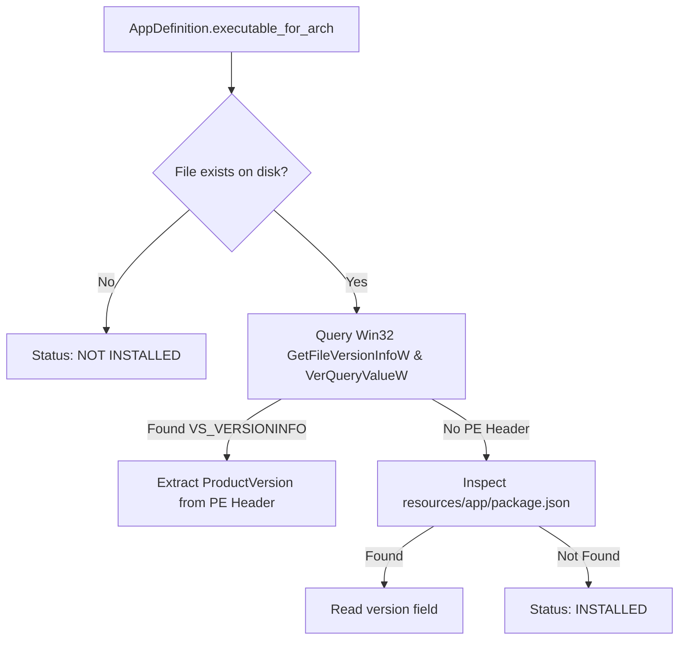

# Architecture Manual: `ppm` (Portable Package Manager)

Technical specification and architectural design of the `ppm` virtualization suite.

---

## 1. System Overview

`ppm` is a native Windows application runner and package manager. It implements user profile virtualization, system call detours, and multi-architecture package resolution.



---

## 2. Directory Layout

```
<USB_ROOT>/
├── ppm.exe                             # Master CLI & Runner
├── antigravity.bat                     # Application Launchers
├── antigravity-manager.bat
│
├── .ppm/                               # Engine runtime data
│   ├── apps.json                       # Declarative application manifest
│   ├── apps.schema.json                # Generated JSON Schema
│   │
│   ├── system/                         # Virtual overlays
│   │   ├── registry.jsonl              # Virtual registry hive (append-only journal)
│   │   └── credentials.json            # Portable credential store (plaintext at rest)
│   │
│   ├── lib/                            # Engine builds, one folder per 64-bit machine
│   │   ├── x64/                        # redirector64.dll (x64) + redirector32.dll (x86)
│   │   └── arm64/                      # redirector64.dll (ARM64) + redirector32.dll (x86); ARM64 builds only
│   │
│   ├── cache/                          # Download cache
│   │   └── ...
│   │
│   └── logs/                           # Runtime logs
│       ├── ppm.<date>.log              # CLI log, daily, 7 kept (filter: PPM_LOG)
│       └── redirector.<date>.log       # Engine log, daily, 7 kept (filter: PPM_LOG)
│
├── Apps/                               # Multi-architecture binaries
│   ├── x64/                            # x64 Application Binaries
│   │   ├── Antigravity/
│   │   ├── AntigravityManager/
│   │   └── WebView2/
│   └── arm64/                          # ARM64 Application Binaries
│       ├── Antigravity/
│       └── WebView2/
│
└── Home/                               # User Profile
    ├── AppData/
    │   ├── Local/                      # %LOCALAPPDATA%
    │   ├── Roaming/                    # %APPDATA%
    │   └── WebViewData/                # %WEBVIEW2_USER_DATA_FOLDER%
    ├── Documents/
    └── ...
```

---

## 3. User-Mode Virtualization Matrix (`redirector.dll`)

```
┌────────────────────────────────────────────────────────────────────────────────────────┐
│                                   VIRTUALIZATION BOUNDARIES                             │
├──────────────────────┬───────────────────────────────┬─────────────────────────────────┤
│ Subsystem            │ Interception Boundary         │ Scope & Target DLL              │
├──────────────────────┼───────────────────────────────┼─────────────────────────────────┤
│ 1. Registry (CoW)    │ kernelbase.dll / advapi32.dll │ Win32 Application Registry APIs │
│ 2. Process Spawning  │ kernelbase.dll / kernel32.dll │ CreateProcess W / A / AsUserW   │
│ 3. Credentials       │ advapi32.dll                  │ Cred Read/Write/Delete/Enumerate│
│ 4. Shell Paths       │ shell32.dll + userenv.dll     │ Known Folders / Profile Paths   │
│ 5. Process Identity  │ shell32.dll                   │ SetCurrentProcessExplicitAppId  │
└──────────────────────┴───────────────────────────────┴─────────────────────────────────┘
```

| Target API | Interception Layer | Virtualization Function |
| :--- | :--- | :--- |
| **`CreateProcessW`, `CreateProcessA`, `CreateProcessAsUserW`** | `kernelbase.dll` / `kernel32.dll` | Injects the engine into every spawned child via Microsoft Detours. Each entry point reaches `CreateProcessInternal*` on its own, so all three are hooked. The child is created frozen (`CREATE_SUSPENDED`), its mitigation policies queried from the kernel (CIG/ACG), and it is either injected with the engine build for the machine it runs as - through a Detours helper when its bitness differs (ADR-007) - or run uninjected in its own sandbox (hardened); an unverifiable policy, a failed injection or a failed resume all fail the spawn with the real OS error - see ADR-006. |
| **`RegOpenKeyExW`** | `kernelbase.dll` / `advapi32.dll` | Normalizes registry paths (`HKCU\...`, `HKLM\...`); tracks handle in `VirtualHandleTable`. |
| **`RegCreateKeyExW`** | `kernelbase.dll` / `advapi32.dll` | Creates key in virtual overlay; registers handle in `VirtualHandleTable`. |
| **`RegQueryValueExW`** | `kernelbase.dll` / `advapi32.dll` | Queries virtual overlay and tombstones; falls back to host OS for unshadowed reads. Unreadable stored bytes read as absent rather than unmasking host data. |
| **`RegGetValueW`** | `kernelbase.dll` / `advapi32.dll` | Resolves `lpSubKey` against the overlay. Without this hook the API opened its subkey through an internal entry point and the read escaped to the host. Applies the `RRF_RT_*` type filter, REG_EXPAND_SZ expansion and the string NUL-termination guarantee. |
| **`RegSetValueExW`** | `kernelbase.dll` / `advapi32.dll` | Stores the typed value in memory and appends one record to the `.ppm/system/registry.jsonl` journal. Appending is O(1) and cannot erase another process's records - the previous shape re-serialized the whole hive per write, so one injected process's snapshot silently dropped the keys another had written. |
| **`RegDeleteValueW`, `RegDeleteKeyW`, `RegDeleteKeyExW`, `RegDeleteTreeW`** | `kernelbase.dll` / `advapi32.dll` | Records tombstones in the virtual store, masking host values and keys. `RegDeleteKeyExW` and `RegDeleteTreeW` reach `RegDeleteKeyExInternalW` without passing through `RegDeleteKeyW`, so leaving them unhooked deleted keys in the **real host registry**. Tombstones resolve through ancestors, so a deleted key also masks host-only children; `RegDeleteTreeW` keeps the key and masks its subkeys and values. |
| **`RegEnumKeyExW`, `RegEnumValueW`, `RegQueryInfoKeyW`** | `kernelbase.dll` / `advapi32.dll` | Serve one merged listing: the host's own entries, minus everything the overlay masks, plus everything it added, with names spelled as the application wrote them. All three read the same per-handle snapshot, because `RegQueryInfoKeyW` reports the counts a caller sizes its buffers and bounds its loop from - a count that disagreed with the walk would make callers miss entries or stop early. The snapshot is invalidated by an overlay generation counter and dropped when the handle closes. |
| **`RegOpenCurrentUser`** | `kernelbase.dll` / `advapi32.dll` | Registers the returned handle as the `HKCU` hive so operations on it stay tracked. |
| **`RegCloseKey`** | `kernelbase.dll` / `advapi32.dll` | Cleans up handles in `VirtualHandleTable`. |
| **`CredReadW`/`A`, `CredWriteW`/`A`, `CredDeleteW`/`A`, `CredEnumerateW`/`A`** | `advapi32.dll` | Intercepts credentials and persists to `.ppm/system/credentials.json` (plaintext at rest - see SPEC §3). Reads, deletes and enumerations are clean-roomed: the host credential store is never modified and never leaks into the application. |
| **`SHGetKnownFolderPath`** | `shell32.dll` | Redirects `FOLDERID_Profile`, `FOLDERID_LocalAppData`, `FOLDERID_RoamingAppData`, `FOLDERID_Documents` to `<root>\Home\...`. |
| **`GetUserProfileDirectoryW`** | `userenv.dll` | Returns `<root>\Home` as user profile directory. |
| **`SetCurrentProcessExplicitAppUserModelID`** | `shell32.dll` | Proactively sets a root-scoped identity (`PPM.Portable.<root-hash>.<App>`) during DLL attach, and maps app-initiated calls into the same isolated domain. |
A registry handle the engine never watched being opened has no knowable key path. Reads on such
a handle fall through to the host (the documented copy-on-write behavior), while mutations are
refused with `ERROR_INVALID_HANDLE`: writing through to the host would breach the boundary, and
accepting the write under a placeholder key would store it where no read could reach it.

ANSI registry APIs (`RegSetValueExA`, `RegQueryValueExA`, `RegEnumValueA`, …) are independent
implementations in kernelbase that do not route through their wide counterparts, so they remain
a known gap rather than covered surface.

An enumeration reports no class string and a zeroed last-write time for a subkey: the overlay
records neither, and the merged index does not map back to a host index that could supply them.
Zero is the documented "unknown" here, not a fabricated value.

Kernel synchronization objects, named pipes, and host window discovery are intentionally **not**
intercepted. An exploration of that boundary (33 additional Win32 detours) is preserved on the
`explore/sync-isolation` branch and can be resurrected if a real application exhibits fixed-name
single-instance or IPC collisions.

---

## 4. Version Resolution Engine

`ppm` inspects local executables on disk dynamically without maintaining intermediate state files:



---

## 5. Source Tree Layout

### A. `crates/redirector/src/`
```
crates/redirector/src/
├── lib.rs                          # DLL Entrypoint (helper check, import restore) & Hook Orchestration
├── paths.rs                        # Path Resolution (Home/, .ppm/logs/, .ppm/system/)
├── detour.rs                       # Hook Attach, Re-Entrancy Guard & Export-Resolution Seam
├── winstr.rs                       # Win16 String, UTF-16 Encoding & COM-Task Allocators
├── persist.rs                      # Loud-Failure JSON State Persistence (load/persist)
│
├── registry/                       # Registry Virtualization
│   ├── mod.rs                      # Registry module export & initialization
│   ├── store.rs                    # In-Memory Hive, Ancestor-Aware Tombstones & Op Model
│   ├── journal.rs                  # Append-Only Op Journal, Replay & Compaction (.ppm/system/registry.jsonl)
│   ├── enumeration.rs              # Host+Overlay Merged Listing & Per-Handle Snapshot Cache
│   ├── handle_table.rs             # Virtual Handle Table, Key Scope & Pseudo-Handle Mapping
│   └── hooks.rs                    # Win32 (KernelBase / advapi32) Detour Hooks
│
├── process/                        # Process Virtualization
│   ├── mod.rs                      # Process module export & initialization
│   └── hooks.rs                    # CreateProcessW / A / AsUserW Detour Hooks
│
├── credentials/                    # Credential Store Virtualization
│   ├── mod.rs                      # Credentials module export & initialization
│   ├── vault.rs                    # Portable Credential Vault, keyed by target+type (.ppm/system/credentials.json)
│   └── hooks.rs                    # Cred* API Detours
│
└── shell/                            # Shell & Profile Virtualization
    ├── mod.rs                        # Shell module export & initialization
    ├── folders.rs                    # SHGetKnownFolderPath, GetUserProfileDirectoryW
    ├── identity.rs                   # Root-Scoped AUMID Namespace (policy & hooks)
    └── badge.rs                      # Portable Mode Overlay Badge & Monitor
```

### B. `crates/ppm/src/`
```
crates/ppm/src/
├── main.rs                         # CLI Entrypoint (parse -> resolve root -> log sinks -> execute -> exit code)
│
├── cli/                            # Command-Line Interface Layer
│   ├── mod.rs                      # Cli/Commands Definitions & Dispatch
│   ├── context.rs                  # Root Resolution & Manifest Loading
│   ├── logging.rs                  # Console (stderr) & rotating file log sinks
│   ├── pipeline.rs                 # Dependency Ordering & Install Pipeline
│   └── commands/                   # One Module Per Command
│       ├── init.rs  run.rs  check.rs  install.rs  update.rs
│       └── link.rs  list.rs  schema.rs  validate.rs
│
├── core/                           # Core Domain
│   ├── mod.rs
│   ├── arch.rs                     # CpuArch, ArchTarget & Win32 CPU Detection (GetNativeSystemInfo)
│   ├── config.rs                   # AppManifests, AppDefinition (serde/schemars), reference checks
│   ├── layout.rs                   # PortableLayout: the single owner of on-disk locations
│   ├── relpath.rs                  # Relative paths confined to their base directory
│   ├── schema.rs                   # JSON Schema artifact writer
│   └── assets.rs                   # Embedded per-machine engine builds & default apps.json
│
├── engine/                         # Engine Domain
│   ├── mod.rs
│   ├── init.rs                     # Workspace Scaffolding (.ppm/, Apps/, Home/)
│   ├── runner.rs                   # Process Execution & Win32 Argument Quoting
│   └── launcher.rs                 # Launcher Script Generator
│
└── package/                        # Package Domain
    ├── mod.rs
    ├── pe_info.rs                  # PE Version Header Extractor (GetFileVersionInfoW)
    ├── version.rs                  # Version Resolution & Update Checking
    ├── http.rs                     # Shared HTTP clients (User-Agent, timeouts)
    ├── downloader.rs               # HTTPS-only Downloader with Progress Reporting
    ├── extractor.rs                # Archive Extractor (NSIS-7z, 7z, Zip, Tar/gzip, CAB, MSI) & atomic swap-in
    ├── msi_layout.rs               # MSI Directory/Component/File/Media tables -> administrative-image paths
    └── sanitizer.rs                # Post-Install Cleanup
```

### C. `crates/injection/` and the engine-build crates
```
crates/injection/                   # Shared by ppm (root launch) and redirector (children) - ADR-007
├── build.rs                        # Compiles vendored Microsoft Detours once per target
└── src/
    ├── lib.rs                      # inject_suspended: machine -> engine choice -> Detours
    ├── detours.rs                  # Detours API (extern "system")
    ├── machine.rs                  # Machine of a process / of the host
    └── engine.rs                   # choose_engine (pure), ANSI path encoding

crates/engine-x86/                  # redirector.dll built for i686, embedded by every ppm
crates/engine-x64/                  # redirector.dll built for x86_64, embedded by ARM64 ppm
crates/probe-x86/                   # test-probe built for i686 (cross-bitness e2e)
```

### D. Verification Probe & Integration Tests
```
crates/test-probe/                  # Isolated probe package (bin-artifact dev-dependency of ppm)
├── src/main.rs                     # Suite Dispatcher (--child / --echo-args / --help modes)
├── src/support.rs                  # UTF-16 Marshalling Helpers
└── src/suites/                     # One Suite Per Isolation Boundary
    ├── registry.rs                 # Registry Copy-on-Write
    ├── shell.rs                    # Known-Folder Redirection
    ├── credentials.rs              # Credential Vault
    ├── injection.rs                # Child-Process Re-Injection
    └── identity.rs                 # Taskbar AUMID Contract

crates/ppm/tests/
├── e2e_virtualization.rs           # Integration test consuming the probe via CARGO_BIN_FILE_* edge
├── init_semantics.rs               # `ppm init` idempotency and engine deployment
├── package_extraction.rs           # Extractor fixtures (zip, 7z/LZMA2, CAB, MSI embedded/external)
└── fixtures/                       # Sample archives
```

The toolchain is pinned to a dated nightly in `rust-toolchain.toml`; `.cargo/config.toml` opts into
the `bindeps` unstable feature that enables the bin-artifact dependency edge above.

---

## 6. Build & Test Workflow

```bash
# Run unit and integration test suite (probe builds automatically as a bin-artifact dev-dependency)
cargo test --workspace

# Run static analysis and clippy lints
cargo clippy --workspace --all-targets

# Compile release binaries (dev-dependencies absent from release graphs - probe never leaks)
cargo build --release
```

**Build Output**: `target/release/ppm.exe`.
